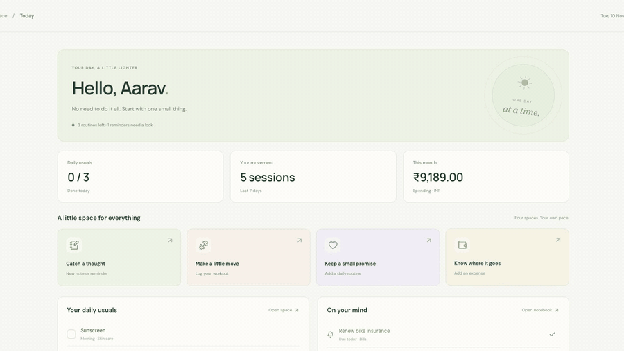

# LifeOS — our first chapter

A Flutter mobile app for **Android and iOS**, a matching **React website**, and **one Express backend connected to one MongoDB database**.

**Live website:** https://lifeos-jateen.netlify.app

[](docs/demo.mp4)

▶ [Watch the full 20-second demo with sound](docs/demo.mp4)

## Real Android phone: login on Wi-Fi or mobile data

`10.0.2.2` only connects an Android emulator to your computer.
A real phone needs an online backend to work across different networks.
Follow [Online backend setup](docs/ONLINE_BACKEND.md) to deploy with `render.yaml` and MongoDB Atlas.
Then run `npm run setup:api` and paste the real deployed HTTPS address.
Run `npm run build:android` to build the installable app with that address.
The setup checks the backend and database before saving the URL.
The cloud deployment still needs your hosting account and private code repository.

## What's new

- **LifeOS AI (free, no key):** Personal AI now works on the live website. The server holds free AI keys
  (Groq first, then Google Gemini, then OpenRouter) and falls back automatically. Each user gets a daily allowance.
  Local Ollama and your own OpenAI / AWS Bedrock keys still work.
- **Tell LifeOS:** type "Spent 250 on lunch with Rahul yesterday", "Remind me to pay rent on the 1st" or
  "Ran 5 km for 30 minutes". The AI uses tool calling to propose one entry, you check it, then press Save.
  Spending questions ("How much on food this month?") are answered from your own data.
  The AI can only propose; the normal, validated create endpoint does the saving.
- **Try the demo:** one click on the sign-in page opens a private sample account (workouts, spending, reminders,
  routines). Every visitor gets their own, and it is deleted automatically after 24 hours.
- **Delete account on the website** (it was mobile-only).
- **Fair rate limits behind the proxy:** web users all arrive from the Netlify IP, so limits are now per session
  and per account instead of per IP.
- **Lighter polling:** the 30-second refresh uses an ETag and gets `304 Not Modified` when nothing changed.
- **CI:** GitHub Actions runs the JavaScript tests, a MongoDB integration test, the web build and the Flutter tests.

## Current features

This milestone includes email/password registration, ID/email + password login, Google sign-in, independent daily workspaces, session restoration, and logout.
The same account works on web, Android, and iOS.
Users can permanently delete their LifeOS account on the website or mobile after confirming their password or Google identity. See [Account deletion](docs/ACCOUNT_DELETION.md).
There is no email verification, password-reset flow, or account-linking flow yet.
The small card on the website's left side is decorative.

After login, both apps open **Today**, a quick daily overview with four independent spaces:

- **Notes & reminders:** create, edit, search, tag, pin, archive, and restore notes. Date-based reminders can be completed and reopened.
- **Workout tracker:** log sessions, minutes, exercises, sets, and effort. See your last seven days and reuse a past session.
- **Daily routines:** choose repeat days and time of day. Save daily check-ins, undo them, and see history and scheduled-day streaks.
- **Spending tracker:** save exact INR expenses, categories, payment methods, monthly budgets, and category summaries. Export CSV on web or copy CSV on mobile.
- **Payment context:** review payments, remember recipient details, exclude self transfers, track lending and returns, and split trip costs on web and mobile.

Supported Android phones can also check future notifications after explicit permission
and queue recognised English INR payment confirmations for your review.
Only payments you save as Spending become expenses. An optional Android floating reminder opens the full review in LifeOS.
Old notifications are not imported. iPhone keeps manual recording and synced review cards.
See [notification spending setup](docs/NOTIFICATION_SPENDING.md) for privacy and phone limits.

Use the website sidebar or mobile bottom navigation to open each space.
Each web space has its own address, such as `http://localhost:5173/#notes`.
Today offers quick entry buttons, routine check-offs, due reminders, movement totals, and monthly spending.
All entries are stored in MongoDB under the signed-in account. No tracker data is kept in browser local storage.
Use **Refresh saved spaces** to pick up changes from another device. Changes are not streamed live.
Failed saves keep the entry form open. Deleting an entry asks for confirmation.
Android detected payments have an encrypted offline waiting list.
Web refreshes visible screens every 30 seconds. Mobile refreshes on return and detected-payment events.
Reminder notifications and offline manual editing are not implemented.
See [the workspace guide](docs/WORKSPACES.md) for the feature list and code layout.

The web login uses two columns on wide screens and one column at 900 pixels or less.
Both apps keep the form narrow enough to read and allow vertical scrolling on small screens.
The mobile form also supports large text and an open keyboard. Form changes and login errors scroll into view.

## 1. Understand what we are building

Think of a restaurant:

- **Flutter and React are the dining areas:** the screens people interact with.
- **Express is the kitchen:** it checks requests and decides what should happen.
- **MongoDB is the storage room:** it keeps users and sessions.
- **Google is an identity checker:** it confirms who someone is; our backend still creates their LifeOS session.

```text
Flutter → Android ─┐
Flutter → iOS ─────┼── Express API ── MongoDB
React → browser ──┘        │
                           └── Verifies Google identity tokens
```

Android and iOS are **two builds of the same Flutter app**, not two separate mobile codebases. React is a separate web frontend. MERN means **MongoDB + Express + React + Node.js**; Flutter joins the same Node/Express API.

## 2. Know where the code lives

```text
LifeOs/
├── apps/web/       React login website and tabbed home screen
├── apps/mobile/    Flutter login and home screens, Android and iOS projects
├── server/         Express API, MongoDB models and authentication
├── docs/           Beginner lessons, Google setup and API reference
├── scripts/        Safe configuration-file setup
└── compose.yaml    Local MongoDB container
```

Start by reading [the beginner lesson](docs/LEARNING_GUIDE.md). Read files in the order shown there rather than trying to understand everything at once.

## 3. Have these tools ready

- Node.js **22.12+**; an active LTS release is preferable.
- Flutter **3.41+** / Dart **3.11+** for this generated project.
- Docker Desktop, running, for local MongoDB. Alternatively, use your own MongoDB or MongoDB Atlas connection string.
- Android Studio + Android SDK/emulator for Android.
- On a Mac: Xcode + an iOS simulator for iOS. CocoaPods may be needed depending on Flutter’s native plugin build mode.

Check your computer with `node --version`, `flutter doctor`, and `docker info`. You need only Node and MongoDB to try the web app first.

## 4. Install packages and create your local settings

In a terminal at the project root:

```sh
npm install
npm run setup
```

`setup` copies examples into `server/.env`, `apps/web/.env`, and `apps/mobile/config/development.json`. It **never overwrites existing settings**. Actual `.env` files and mobile development configuration are ignored by Git.

These files are settings, not app code. For example, `MONGODB_URI` tells the backend where its database lives. **Never put the MongoDB URI or database password in Flutter or React.** Google client IDs are public identifiers, not passwords; this ID-token flow does not need a client secret.

## 5. Start MongoDB and create the learning account

```sh
npm run db:up
docker compose ps
npm run seed
```

The MongoDB service should be running before you seed. If you prefer Atlas, put its connection string in `server/.env` and skip the Docker commands.

For local learning, the example account is:

| Field    | Value                   |
| -------- | ----------------------- |
| ID       | `demo`                  |
| Email    | `demo@lifeos.local`     |
| Password | `ChangeMe-LifeOS-2026!` |

You can change the `SEED_*` values **before the first seed**. The seed hashes the password and creates one account. Re-running it does not reset an existing account or change its password. The seed is blocked in production. The published example password is **only for local learning**.

## 6. Run the API and React website

```sh
npm run dev
```

Open `http://localhost:5173` in your browser. The API runs at `http://localhost:4000/api`; its health endpoint is `/api/health`.

Click **New here? Create account** to register with your own email and password.
Enter your name, email, password, and matching confirmation.
The password needs at least 8 characters and at most 72 bytes.
Registration signs you in immediately. No seed account is required.
Sign out, then sign in with that email on web or mobile.
Refresh or restart to check that your login is remembered.
The website uses Vite's `/api` proxy locally, so cookies and requests use your website's origin.
See [the email login guide](docs/EMAIL_AUTH.md) for small steps and error fixes.

If you change the API port, also change `apps/web/vite.config.js` and the mobile API URL. If you change the website origin, update `WEB_ORIGINS` and your Google web client’s authorized origins. Vite deliberately refuses to silently choose a different port.

## 7. Run the same login app on mobile

Keep `npm run dev` running. Open a **second terminal**:

```sh
cd apps/mobile
flutter pub get
flutter devices
flutter run --dart-define-from-file=config/development.json
```

Pick your Android emulator or iOS simulator when Flutter asks. For a specific device, add `-d DEVICE_ID` using an ID from `flutter devices`.

From the root folder, you can instead run `npm run dev:mobile`.
It always includes `config/development.json`.
Use `npm run dev:mobile -- -d DEVICE_ID` for a specific simulator.
In VS Code, select **LifeOS mobile** and your simulator, then press **F5**.
Plain `flutter run` does not load the Google settings file automatically.
After `npm run setup:google`, iOS can also read both Google IDs from its native app settings.
This fixes Google login when starting from Xcode or plain `flutter run` without the settings-file argument.
Android still requires the command above.
Custom API addresses still require `--dart-define-from-file` on both platforms.

With an empty `API_BASE_URL`, the app automatically selects:

| Where Flutter runs | Backend address                                     |
| ------------------ | --------------------------------------------------- |
| Android emulator   | `http://10.0.2.2:4000/api`                          |
| iOS simulator      | `http://127.0.0.1:4000/api`                         |
| A real phone       | Set `http://YOUR_COMPUTER_LAN_IP:4000/api` yourself |

On a real phone, connect it and your computer to the same Wi-Fi and allow access to port 4000 in your firewall. `localhost` on a phone means **the phone**, not your computer. The API listens on all interfaces for this development workflow; keep it on a trusted network.

Local HTTP is permitted only by the Android/iOS **debug** configurations. Release builds require an HTTPS API URL. Configuration from `--dart-define-from-file` is baked into the build, so restart/rebuild after changing it; hot reload is not enough.

## 8. Enable real Google sign-in

Follow [Google Auth setup](docs/GOOGLE_AUTH.md) to create web, Android and iOS OAuth clients in your own Google project.

**Google login requires your real client IDs.** There are no fake OAuth credentials. The website disables Google until its client ID is configured. On mobile, tapping Google explains any missing setup. Password login works independently. Once configured, Google creates a LifeOS user on the first sign-in and uses the same database account on subsequent platforms.

After creating your Google Web application client, run:

```sh
npm run setup:google
npm run setup:google -- --check
```

The first command asks for your Web client ID and an optional iOS client ID.
It puts the matching IDs into the website, backend, and Flutter settings.
It also saves both native iOS client IDs and the iOS return URL.
It keeps your database address and other settings.

The second command only checks your local files. It cannot check the origins, Android signing fingerprint or client types in your Google project. Restart the app and test a real Google account after completing the guide.

## 9. Check your work

From the root:

```sh
npm test
npm run test:integration
npm run lint
npm run build
npm run format:check
```

`npm test` runs backend and React tests without MongoDB. `test:integration` requires MongoDB and verifies real account and workspace persistence, shared web/mobile data, atomic routine check-ins, session expiry and logout in `lifeos_test`. It only removes the records it creates. Override its connection with `TEST_MONGODB_URI`; the database name must end in `_test`.

For mobile:

```sh
cd apps/mobile
flutter analyze
flutter test
```

With the seeded API running and a simulator/emulator connected, you can also run a native end-to-end test that exercises real platform secure storage and MongoDB:

```sh
flutter test integration_test/auth_flow_test.dart -d DEVICE_ID --dart-define-from-file=config/development.json
```

This test uses the example `demo` account. If you changed it, supply `--dart-define=TEST_LOGIN_ID=YOUR_ID` and `--dart-define=TEST_PASSWORD=YOUR_PASSWORD` as well. It signs out the app’s current session first and ends by logging out its test session.

Automated Google-success tests use a fake identity verifier; they do not prove your own Google project is configured correctly. Test actual Google account selection on the browser, an Android device/emulator and an iOS device/simulator after completing OAuth setup.

## 10. Learn the next layer

- [Beginner lesson](docs/LEARNING_GUIDE.md): what happens when you press Sign in, with a recommended reading order.
- [Email registration and login](docs/EMAIL_AUTH.md): create an account and use it on all three platforms.
- [Google Auth setup](docs/GOOGLE_AUTH.md): how the three OAuth clients connect.
- [API reference and production checklist](docs/API.md): requests, responses and what still needs work before public launch.
- [Workspace guide](docs/WORKSPACES.md): daily features, storage, and separate module files.
- [Notification spending](docs/NOTIFICATION_SPENDING.md): Android permissions, background saving, privacy, and iPhone limits.
- [Money review](docs/MONEY_REVIEW.md): payment context, remembered recipients, people balances, trip splits, and API fields.
- [Personal AI](docs/PERSONAL_AI.md): local workout, skin care, and spending questions, your own knowledge, and optional OpenAI or AWS Bedrock credentials.

This is a working authentication foundation for learning, **not a claim that the app is ready for production or App Store submission**.
Email verification, password reset, reminder notifications, and offline editing still need separate work.
